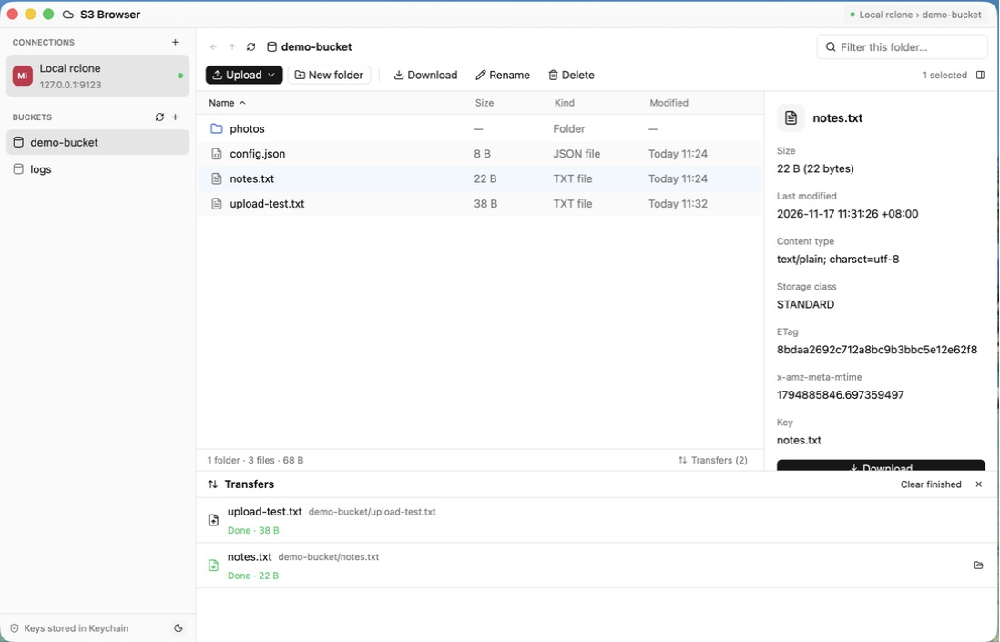

# S3 Browser

A native desktop file manager for Amazon S3 and S3-compatible object storage, built in Rust with [GPUI Kit](https://github.com/longbridge/gpui-kit) (GPUI + gpui-component).



It borrows its connection model from [s3fs-fuse](https://github.com/s3fs-fuse/s3fs-fuse): an endpoint URL (`-o url=`), a region, path-style addressing (`-o use_path_request_style`) and credentials from `~/.aws/credentials` or `~/.passwd-s3fs`. S3 Browser does not mount a filesystem. It talks to the S3 API directly, which avoids FUSE's latency and POSIX limits.

## Providers

Presets fill in the endpoint, region and addressing style:

| Provider | Endpoint | Notes |
| --- | --- | --- |
| Amazon S3 | regional (SDK default) | GovCloud regions work too |
| Cloudflare R2 | `https://<account>.r2.cloudflarestorage.com` | region `auto`; set *Default bucket* for bucket-scoped tokens |
| MinIO | `http://localhost:9000` | path-style |
| Backblaze B2 | `https://s3.<region>.backblazeb2.com` | |
| Wasabi | `https://s3.<region>.wasabisys.com` | |
| DigitalOcean Spaces | `https://<region>.digitaloceanspaces.com` | |
| Google Cloud Storage | `https://storage.googleapis.com` | HMAC keys (XML interop API) |
| Akamai / Linode | `https://<region>.linodeobjects.com` | |
| Scaleway | `https://s3.<region>.scw.cloud` | |
| Hetzner | `https://<region>.your-objectstorage.com` | |
| Other | any URL | Ceph RGW, SeaweedFS, Garage, IDrive e2, rclone, … |

For non-AWS endpoints the client sends checksums only when the operation requires them. Many S3-compatible stores reject the newer default CRC headers.

## Features

**A Spacedrive-style explorer**
- Floating sidebar with a connection switcher, a Buckets list, and a Library section (Overview, Transfers, Cache & previews).
- Three views:
  - **Grid**: thumbnails, names and sizes, in three zoom sizes.
  - **List**: sortable columns.
  - **Media**: dense square photo wall of images and videos only.
- Floating inspector: large preview plus Details, Dates, Storage (including *cached locally*) and Metadata sections, with Quick Look, open, download, share-link, copy-URI and delete actions.
- **Quick Look**: <kbd>Space</kbd> or double-click previews images full-size. <kbd>←</kbd>/<kbd>→</kbd> step through the folder; other files open in their default app.
- Path bar with clickable breadcrumbs, a floating transfers panel, and drag-and-drop upload from Finder.
- Light and dark palettes. The gpui-component dialogs, menus and inputs are re-tinted to match.

**Thumbnails and the egress-saving cache**
- Thumbnails load lazily for what's on screen, at most four at a time. Anything queued for a folder you've left is dropped before it's fetched.
- Images are decoded with EXIF orientation applied. HEIC, PDF and PSD go through macOS Quick Look (`qlmanage`).
- Every byte fetched is kept in `~/Library/Caches/S3 Browser`: the full object, plus a ~384 px thumbnail. The cache key is endpoint + bucket + key, validated against the listing's **ETag and size**, so a changed object is fetched again and an unchanged one never is.
- What the cache saves:
  - Reopening the app shows thumbnails from disk.
  - Quick Look, *Open* and *Download* of a cached object copy it locally (an APFS clone), with zero egress.
  - Files you upload (up to 64 MB) are seeded into the cache with their thumbnail, so viewing them later costs nothing.
- Settings:
  - Thumbnails: on/off.
  - Largest image to thumbnail: 5–200 MB. Larger photos show an icon until opened.
  - Cache size limit: 1–50 GB, evicting least-recently-used first.
- The sidebar shows how many bytes were served from cache instead of fetched.

**Storage operations**
- Connections are saved locally, with secret keys in the macOS Keychain. Keys can be imported from `~/.aws/credentials` or `~/.passwd-s3fs`.
- *Test* checks a connection before you save it.
- Buckets: list, create, delete. If a key can't call ListBuckets, the app falls back to the connection's default bucket.
- Listings load 1,000 keys at a time, with *Load more* for the rest, in a virtualized list.
- New folder creates a zero-byte `name/` marker.
- Rename is a server-side copy plus delete, recursive for folders.
- Delete runs in batches of 1,000 and falls back to per-key deletes where DeleteObjects isn't supported (GCS).
- Pre-signed share links last 1 hour, 24 hours or 7 days.
- Transfers:
  - Files over 16 MiB use multipart upload; downloads stream to disk.
  - Up to 4 transfers run at once, with cancel and *Show in Finder*.

**Keyboard**

| Shortcut | Action |
| --- | --- |
| Arrows | Move the selection |
| Space | Quick Look |
| Enter | Open the selected item |
| ⌘A | Select all |
| ⌘⌫ | Delete |
| ⌘↑ | Enclosing folder |
| ⌘[ / ⌘] | Back / forward |
| ⌘R | Refresh |
| Esc | Clear the selection or close the preview |

## Build and run

Requires Rust 1.85 or later (edition 2024). On macOS the Xcode Command Line Tools are enough; Metal shaders compile at runtime.

```bash
cargo run
```

Build a `.app` bundle in `target/S3 Browser.app` (release by default, or pass `debug`):

```bash
scripts/bundle.sh
```

```bash
open "target/S3 Browser.app"
```

The app icon is `assets/icon/AppIcon.svg`. After editing it, regenerate the `.icns` (rendered with resvg, packed with `iconutil`):

```bash
scripts/make_icon.sh
```

**Code signing and the Keychain.** `scripts/sign.sh` signs every build (both `scripts/bundle.sh` and `cargo run`, via the runner in `.cargo/config.toml`). It uses the first **Apple Development** certificate in your keychain, or `$S3B_SIGN_IDENTITY` if set. macOS then knows the app by your team ID, so "Always Allow" on the Keychain prompt lasts across rebuilds. To get a certificate (a free Apple ID works):
1. In Xcode, open Settings → Accounts, then Manage Certificates → + → Apple Development.
2. Make sure Apple's "Worldwide Developer Relations – G3" intermediate is in your login keychain.

Without a certificate the script falls back to ad-hoc signing, and macOS asks once per rebuild. To check that a build can read the saved keys without a prompt:

```bash
"target/S3 Browser.app/Contents/MacOS/s3-browser" --check-keychain
```

## Tests

```bash
cargo test
```

Unit tests cover the cache (version validation, thumbnail size, HEIC via Quick Look), INI and passwd parsing, natural sort, size formatting, bucket-name rules and copy-source encoding. A live end-to-end test runs every S3 operation the app uses: create bucket, folder marker, upload, list, HEAD, download with a byte-for-byte check, file and folder rename, presign, and recursive delete.

A second live test proves the egress savings: the first thumbnail fetches the object, the second fetches nothing, and a later download is served from the cache. It also checks pagination past 1,000 keys and a 1,050-key batch delete. It runs only when these are set:

```bash
rclone serve s3 --auth-key testkey,testsecret123 --addr 127.0.0.1:9123 --vfs-cache-mode writes ./s3data
```

```bash
S3_TEST_ENDPOINT=http://127.0.0.1:9123 S3_TEST_KEY=testkey S3_TEST_SECRET=testsecret123 cargo test live
```

Add `S3_TEST_MULTIPART=1` against MinIO or real S3 to exercise multipart upload. rclone's built-in S3 server returns a malformed `CreateMultipartUpload` response, so that case is skipped against it by default.

## Layout

```
src/main.rs             app start-up, window, panic log
src/app.rs              app state & behaviour (navigation, selection, transfers, dialogs)
src/ui/                 rendering: sidebar, explorer (grid/list/media), inspector, overlays
src/cache.rs            disk cache: objects, thumbnails, LRU, egress stats
src/theme.rs            Spacedrive-style palette; re-tints gpui-component
src/settings.rs         view, zoom, preview & cache preferences
src/connection_form.rs  new/edit connection form
src/providers.rs        provider presets
src/s3.rs               S3 client on a private tokio runtime (aws-sdk-s3)
src/store.rs            saved connections, Keychain, credential import
src/transfers.rs        transfer jobs and progress
src/util.rs             formatting, MIME types, file icons
src/assets.rs           extra Lucide icons + folder/file/bucket artwork (assets/art)
scripts/bundle.sh       .app bundler
```

The AWS SDK needs a tokio reactor and GPUI has its own executor. All S3 calls run on a dedicated tokio runtime, and the UI awaits their `JoinHandle`s from GPUI tasks (`s3::spawn`). Transfer progress lives in atomics that the UI samples four times a second while transfers are active.

If the app ever crashes, the panic message and backtrace are appended to `~/Library/Application Support/S3 Browser/panic.log`.
