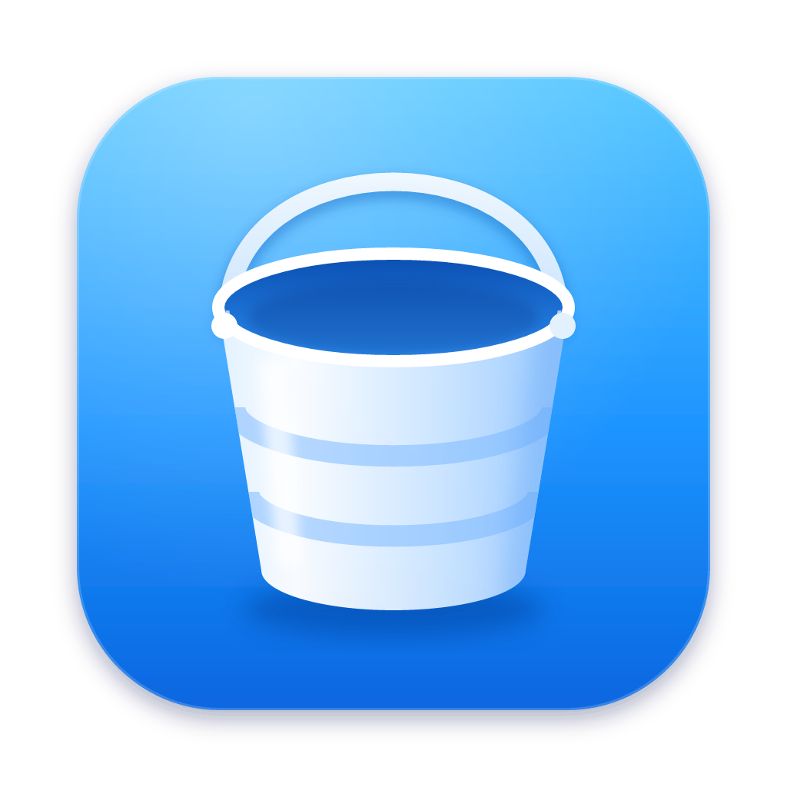

<div align="center">



# S3 Browser

**A fast, native macOS file manager for Amazon S3 and every S3-compatible storage.**

Browse buckets like a local drive, with thumbnails, Quick Look, folder sizes and a local cache that keeps you from paying egress twice for the same file.

Built in Rust with [GPUI Kit](https://github.com/longbridge/gpui-kit).


[](LICENSE)

</div>


## Highlights

- **Explorer in the style of Spacedrive.** Grid, list and media views with real image thumbnails, a floating sidebar and an inspector panel.
- **Quick Look.** Press <kbd>Space</kbd> to preview an image full-size and <kbd>←</kbd> <kbd>→</kbd> to flip through the folder.
- **Pay egress once.** Every file and thumbnail you fetch is cached on disk and checked against the object's ETag. Re-opening, previewing or downloading it again costs nothing, and the sidebar shows how much you've saved.
- **Works with any S3 store.** Presets with logos for Amazon S3, Cloudflare R2, MinIO, Backblaze B2, Wasabi, DigitalOcean Spaces, Google Cloud Storage, Akamai/Linode, Scaleway, Hetzner, or any custom endpoint.
- **Folder sizes.** S3 has none, so S3 Browser adds them up for you. Select a folder to see its total size and file count.
- **Native Mac app.** Real menu bar and shortcuts, light and dark themes, drag-and-drop upload from Finder, and secret keys kept in the macOS Keychain.


## Install

Build the disk image and drag **S3 Browser** to **Applications**:

```bash
scripts/make_dmg.sh
```

```bash
open "dist/S3 Browser 0.1.0.dmg"
```

The build targets **Apple Silicon** and macOS 12 or later. See [Build and run](#build-and-run) for prerequisites and signing.

## Providers

Presets fill in the endpoint, region and addressing style. You add your keys, or import them from `~/.aws/credentials` or `~/.passwd-s3fs`:

| Provider | Endpoint | Notes |
| --- | --- | --- |
| Amazon S3 | regional (SDK default) | GovCloud regions work too |
| Cloudflare R2 | `https://<account>.r2.cloudflarestorage.com` | region `auto`; set *Default bucket* for bucket-scoped tokens |
| MinIO | `http://localhost:9000` | path-style |
| Backblaze B2 | `https://s3.<region>.backblazeb2.com` | |
| Wasabi | `https://s3.<region>.wasabisys.com` | |
| DigitalOcean Spaces | `https://<region>.digitaloceanspaces.com` | |
| Google Cloud Storage | `https://storage.googleapis.com` | HMAC keys (XML interop API) |
| Akamai / Linode | `https://<region>.linodeobjects.com` | |
| Scaleway | `https://s3.<region>.scw.cloud` | |
| Hetzner | `https://<region>.your-objectstorage.com` | |
| Other | any URL | Ceph RGW, SeaweedFS, Garage, IDrive e2, rclone, … |

The connection model follows [s3fs-fuse](https://github.com/s3fs-fuse/s3fs-fuse): an endpoint URL, a region, optional path-style requests and the same credential files. S3 Browser doesn't mount a filesystem, though. It talks to the S3 API directly, which avoids FUSE's latency and POSIX limits. For non-AWS endpoints it sends checksums only when an operation requires them, because many S3-compatible stores reject the newer default CRC headers.

## Features

**Explorer**
- **Sidebar**: a floating panel with a connection switcher, a Buckets list, and a Library section (Overview, Transfers, Cache & previews).
- **Views**:
  - **Grid**: thumbnails, names and sizes, in three zoom sizes.
  - **List**: sortable columns.
  - **Media**: a dense photo wall of images and videos only.
- **Inspector**: a large preview plus Details, Dates, Storage (including whether the file is cached locally) and Metadata sections. Its actions are Quick Look, open in the default app, download, share link, copy URI and delete.
- **Folders**: selecting one shows its total size and file count. The count stops at 50,000 objects unless you choose *Count everything*, or *Calculate size* from the right-click menu.
- **Navigation**: a path bar with clickable breadcrumbs, back and forward, search, and sorting.
- **Transfers and upload**: a floating transfers panel, and drag-and-drop upload from Finder.

**Thumbnails and the egress-saving cache**
- **Lazy thumbnails**: only what's on screen loads, at most four at a time. Anything queued for a folder you've left is dropped before it's fetched.
- **Formats**: EXIF orientation is applied. HEIC, PDF and PSD thumbnails come from macOS Quick Look.
- **Cache location**: everything fetched is kept in `~/Library/Caches/S3 Browser`, as the full object plus a ~384 px thumbnail. Entries are checked against the listing's **ETag and size**, so a changed object is fetched again and an unchanged one never is.
- **Free repeats**: reopening the app shows thumbnails from disk. Quick Look, *Open* and *Download* of a cached object copy it locally with no egress. Files you upload (up to 64 MB) go straight into the cache with their thumbnail.
- **Settings**: thumbnails on or off, the largest image to thumbnail (5–200 MB), and a cache limit (1–50 GB, least recently used removed first).

**Storage operations**
- **Connections**: saved on your Mac, with secret keys in one Keychain item. *Test* checks a connection before you save it.
- **Buckets**: list, create and delete. If a key can't list buckets, the app falls back to the connection's default bucket.
- **Listings**: 1,000 keys at a time, with *Load more*, in a virtualized list.
- **Folder operations**: *New folder* creates a `name/` marker object. Rename is a server-side copy plus delete, recursive for folders.
- **Delete**: runs in batches of 1,000, with a one-by-one fallback where batch delete isn't supported (GCS).
- **Share links**: pre-signed links valid for 1 hour, 24 hours or 7 days.
- **Transfers**: multipart upload above 16 MiB and streamed downloads, up to 4 at once, with cancel and *Show in Finder*.

## Keyboard shortcuts

| Shortcut | Action |
| --- | --- |
| <kbd>Space</kbd> | Quick Look |
| <kbd>←</kbd> <kbd>→</kbd> <kbd>↑</kbd> <kbd>↓</kbd> | Move the selection (or flip through Quick Look) |
| <kbd>Enter</kbd> | Open the selected item |
| <kbd>⌘</kbd><kbd>1</kbd> / <kbd>2</kbd> / <kbd>3</kbd> | Grid / List / Media view |
| <kbd>⌘</kbd><kbd>=</kbd> / <kbd>⌘</kbd><kbd>−</kbd> | Bigger / smaller thumbnails |
| <kbd>⌘</kbd><kbd>[</kbd> / <kbd>⌘</kbd><kbd>]</kbd> | Back / forward |
| <kbd>⌘</kbd><kbd>↑</kbd> | Enclosing folder |
| <kbd>⌘</kbd><kbd>R</kbd> | Refresh |
| <kbd>⌘</kbd><kbd>N</kbd> | New connection |
| <kbd>⌘</kbd><kbd>U</kbd> / <kbd>⇧</kbd><kbd>⌘</kbd><kbd>U</kbd> | Upload files / folder |
| <kbd>⇧</kbd><kbd>⌘</kbd><kbd>N</kbd> | New folder |
| <kbd>⌘</kbd><kbd>A</kbd> | Select all |
| <kbd>⌘</kbd><kbd>⌫</kbd> | Delete |
| <kbd>⌥</kbd><kbd>⌘</kbd><kbd>S</kbd> / <kbd>I</kbd> / <kbd>T</kbd> | Toggle sidebar / inspector / transfers |
| <kbd>⌘</kbd><kbd>,</kbd> | Cache & previews settings |
| <kbd>Esc</kbd> | Clear the selection or close Quick Look |

## Build and run

You need Rust 1.85 or later (edition 2024). The Xcode Command Line Tools are enough, because Metal shaders compile at runtime.

```bash
cargo run
```

To build a `.app` bundle in `target/S3 Browser.app` (release by default; pass `debug` for a faster build) and open it:

```bash
scripts/bundle.sh
```

```bash
open "target/S3 Browser.app"
```

To package a release build as a drag-to-Applications disk image in `dist/S3 Browser <version>.dmg`:

```bash
scripts/make_dmg.sh
```

**Code signing and the Keychain.** `scripts/sign.sh` signs every build: `scripts/bundle.sh`, `scripts/make_dmg.sh` and `cargo run` (through the runner in `.cargo/config.toml`). It uses `$S3B_SIGN_IDENTITY` if set, otherwise the first **Apple Development** certificate in your keychain. macOS then recognises the app by your team ID, so "Always Allow" on the Keychain prompt survives rebuilds.

To get a certificate with a free Apple ID:
1. In Xcode, open **Settings → Accounts**, add your Apple ID, then choose **Manage Certificates → + → Apple Development**.
2. Make sure Apple's **Worldwide Developer Relations – G3** intermediate certificate ([download](https://www.apple.com/certificateauthority/)) is in your login keychain.

Without a certificate, the script falls back to ad-hoc signing and macOS asks once per rebuild. To check whether a build can read the saved keys without a prompt:

```bash
"target/S3 Browser.app/Contents/MacOS/s3-browser" --check-keychain
```

An Apple Development signature is enough for your own Macs. To give the DMG to other people, sign it with a Developer ID certificate (`S3B_SIGN_IDENTITY`) and notarize it, or Gatekeeper will block it.

The app icon's source is `assets/icon/AppIcon.svg`. After editing it, regenerate the `.icns`:

```bash
scripts/make_icon.sh
```

## Tests

```bash
cargo test
```

The unit tests cover:
- the cache (version checks, thumbnail sizes, HEIC through Quick Look);
- credential-file parsing and natural sort;
- size formatting and bucket-name rules.

The live tests run against any S3 endpoint and are skipped unless `S3_TEST_ENDPOINT`, `S3_TEST_KEY` and `S3_TEST_SECRET` are set. They cover:
- every operation the app performs, including byte-for-byte download checks and folder rename and delete;
- proof of the egress savings: the second thumbnail and a later download fetch nothing;
- pagination past 1,000 keys;
- folder sizes.

To run them against a local server, start one with rclone in one terminal:

```bash
rclone serve s3 --auth-key testkey,testsecret123 --addr 127.0.0.1:9123 --vfs-cache-mode writes ./s3data
```

Then run the tests from another:

```bash
S3_TEST_ENDPOINT=http://127.0.0.1:9123 S3_TEST_KEY=testkey S3_TEST_SECRET=testsecret123 cargo test live
```

Add `S3_TEST_MULTIPART=1` against MinIO or real S3 to exercise multipart upload. rclone's built-in S3 server sends a malformed `CreateMultipartUpload` response, so that case is skipped by default.

## Project layout

```
src/main.rs             start-up, window, panic log, --check-keychain
src/app.rs              state & behaviour: navigation, selection, transfers, dialogs
src/ui/                 rendering: sidebar, explorer (grid/list/media), inspector, overlays
src/menus.rs            native menu bar and keyboard shortcuts
src/s3.rs               S3 client on a private tokio runtime (aws-sdk-s3)
src/cache.rs            disk cache: objects, thumbnails, LRU, egress stats
src/store.rs            saved connections, Keychain vault, credential import
src/connection_form.rs  new/edit connection form
src/providers.rs        provider presets and logos
src/theme.rs            Spacedrive-style palette; re-tints gpui-component
src/settings.rs         view, zoom, preview & cache preferences
src/transfers.rs        transfer jobs and progress
assets/                 app icon, artwork, provider logos
scripts/                bundle, sign, DMG and icon scripts
tools/render_icon.rs    renders the icon SVG to PNGs
```

The AWS SDK needs a tokio runtime, while GPUI has its own executor. So every S3 call runs on a dedicated tokio runtime, and the UI awaits the results from GPUI tasks (`s3::spawn`). If the app ever crashes, the panic message and backtrace are written to `~/Library/Application Support/S3 Browser/panic.log`.

## Credits

- [GPUI](https://www.gpui.rs) and [GPUI Kit / gpui-component](https://github.com/longbridge/gpui-kit) for the UI.
- The design takes inspiration from [Spacedrive](https://github.com/spacedriveapp/spacedrive).
- The connection model comes from [s3fs-fuse](https://github.com/s3fs-fuse/s3fs-fuse).
- Provider logos are from [Simple Icons](https://simpleicons.org) (CC0); the trademarks belong to their owners. Icons are [Lucide](https://lucide.dev).

## License

[MIT](LICENSE) © 2026 Sridhar. Provider logos keep their own terms (see [assets/logos/README.md](assets/logos/README.md)).
